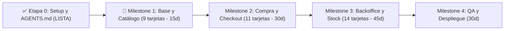

# Hoja de Ruta y Guía de Alineación Técnica — Pet Market Club

**Proyecto:** Plataforma E-commerce B2C Pet Market Club (Taller de Integración 2026 - UADER FCyT)  
**Equipo (3 integrantes):** Maitén Guadalupe Blanc · Enzo Emiliano Etcheto Muñiz · Matías Gabriel Koch  
**Duración Planificada:** 120 días (23/11/2026 – 23/03/2027) · **Metodología:** Kanban en GitHub Projects (WIP máx: 2–3 tarjetas)

---

## 1. Diagnóstico del Estado Actual (Auditoría del Código)

Tras auditar y alinear los repositorios locales [`pet-market-api`] y [`pet-market-store`], la **Etapa 0 (Setup Base y Contexto de Agentes)** ya quedó saneada y commiteada:

* **Repositorio Backend ([`pet-market-api`]):**
  * Inicializado con **Strapi v5.61.0**, TypeScript y **PostgreSQL 16 Alpine** en [`docker-compose.yml`].
  * Documentación y reglas de arquitectura grabadas en [`pet-market-api/README.md`] y [`pet-market-api/AGENTS.md`].
  * **Próximo paso inmediato:** Iniciar la primera tarjeta del tablero (`CU01-HU1`), ya que [`src/api/`] aún no tiene Content-Types creados.
* **Repositorio Frontend ([`pet-market-store`]):**
  * Inicializado con **Next.js 16.4.5** (App Router), **React 19.3.0**, **Tailwind CSS v4** y TypeScript.
  * Cliente HTTP en [`lib/api.ts`] y variables de entorno unificadas (`NEXT_PUBLIC_STRAPI_URL`) en [`.env.example`] y [`pet-market-store/AGENTS.md`].

---

## 2. Análisis Técnico y Advertencia Clave sobre el Orden de las Tarjetas

### Stack Real Instalado
| Capa | Versión Exacta | Regla de Oro para los 3 Desarrolladores |
| :--- | :--- | :--- |
| **Backend** | **Strapi v5.61.0** | Respuestas REST **planas** (sin `.data.attributes`), identificador público `documentId`, y uso obligatorio de `strapi.documents('api::entidad.entidad')` (no usar `entityService` de v4). |
| **Base de Datos** | **PostgreSQL 16** | Corre en Docker (`docker compose up -d`). Las migraciones de esquema viven en el código (`src/api/*/content-types/*/schema.json`). |
| **Frontend** | **Next.js 16.4.5** + **React 19.3** | En Server Components y Route Handlers, `params`, `searchParams`, `cookies()` y `headers()` son **Promesas asíncronas** (requieren `await`). |
| **Estilos** | **Tailwind CSS v4** | Configuración CSS-first en [`app/globals.css`] (`@import "tailwindcss";`). |

> [!IMPORTANT]
> **Cómo manejar las dependencias de Base de Datos entre Milestones (¡Fundamental!):**
> En el tablero Kanban, el **Milestone 1** (Catálogo) y el **Milestone 2** (Compra) van antes que el **Milestone 3** (Backoffice/Admin).
> * ¿Cómo va a ver productos el cliente en `CU01-HU1` (Milestone 1) si la pantalla de Administrador para cargar productos (`CU08-HU1`) recién se programa en el Milestone 3?
> * **Solución arquitectónica:** Cuando una tarjeta del Milestone 1 o 2 tiene el tag `[Base de Datos]`, creamos la **tabla/Content-Type en Strapi** y cargamos **datos semilla (seed)** desde el panel nativo de Strapi (`http://localhost:1337/admin`). Luego, en el **Milestone 3**, programamos las pantallas personalizadas del Backoffice en Next.js y los bloqueos de negocio (`CU08`, `CU03`, `CU09`, `CU10`, `CU11`).

---

## 3. Hoja de Ruta Sincronizada con el Tablero Kanban (34 Tarjetas)



### Regla Operativa para trabajar de a 3 sin pisarse (WIP = 3)
1. **Rama por tarjeta:** Cada tarjeta se trabaja en una rama con su código exacto, por ejemplo: `feat/CU01-HU1-catalogo-categorias`.
2. **Sincronización de `[Base de Datos]`:** Cada vez que una tarjeta incluye el tag **`Base de Datos`**, el integrante que la toma **primero** crea el Content-Type en `pet-market-api`, hace PR a `main` y avisa por Discord para que los otros dos hagan `git pull` antes de tocar Strapi.

---

### 📍 MILESTONE 1: Base y Catálogo Público (Duración: 15 días — 9 Tarjetas)
**Objetivo:** Que el cliente ingrese al sistema, cree su cuenta con redes sociales y explore/busque productos disponibles y agotados.

#### Oleada 1.1 — Cimientos de Catálogo y Login (3 tarjetas en paralelo, 1 por integrante)
1. **`CU01-HU1: Ver catálogo con categorías`** · *Tags: `Frontend`, `Backend`, `Base de Datos`, `Diseño`*
   * **Base de Datos / Backend (`pet-market-api`):** Crear Content-Types `categoria`, `etiqueta` y `producto` (`nombre`, `descripcion`, `precio`, `imagen`, `activo`, `stockActual`, `marca`, `especieDestino`, `presentacion`). Habilitar permisos públicos `find` y `findOne`. Cargar 10 productos de prueba.
   * **Diseño / Frontend (`pet-market-store`):** Crear Layout general (Navbar, Footer), vista de catálogo y grilla de productos filtrable por categoría consumiendo `GET /api/productos?populate=*`.
2. **`CU02-HU1: Autenticación vía Redes Sociales (Registro/Login)`** · *Tags: `Frontend`, `Backend`, `Base de Datos`*
   * **Base de Datos / Backend (`pet-market-api`):** Extender `plugin::users-permissions.user` con campos del Diagrama de Clases (`nombre`, `apellido`, `fechaAlta`, `activo`, rol `Cliente`/`Administrador`) y configurar proveedor OAuth (Google) en Strapi.
   * **Frontend (`pet-market-store`):** Crear pantalla `/login` con botón *"Continuar con Google"* y ruta de callback `/connect/google/redirect` que canjea el token con Strapi.
3. **`CU01-HU2: Visualización de productos sin stock`** · *Tags: `Frontend`, `Backend`*
   * **Backend (`pet-market-api`):** Asegurar que la API devuelva todos los productos con `activo: true` incluso cuando `stockActual === 0` (`RF-06`).
   * **Frontend (`pet-market-store`):** En `ProductCard` y detalle de producto, cuando `stockActual === 0`, renderizar badge claro *"Agotado / Sin Stock"*, aplicar estilo visual atenuado y deshabilitar la acción de compra directa.

#### Oleada 1.2 — Sesión, Perfil y Destacados (3 tarjetas)
4. **`CU02-HU2: Persistencia de Sesión y Carrito mediante cookies`** · *Tags: `Frontend`, `Backend`*
   * **Backend (`pet-market-api`):** Crear Content-Types `carrito` e `item-carrito` asociados al usuario autenticado (`RNF-04`).
   * **Frontend (`pet-market-store`):** Guardar el JWT de Strapi en cookie segura (`cookies()` de Next.js 16 con `await`) y persistir/hidratar el estado del carrito al recargar la página.
5. **`CU02-HU3: Gestión de Perfil y múltiples Direcciones de envío`** · *Tags: `Frontend`, `Backend`, `Base de Datos`, `Diseño`*
   * **Base de Datos / Backend (`pet-market-api`):** Crear Content-Type `direccion` (`calle`, `numero`, `ciudad`, `provincia`, `codigoPostal`, `esPredeterminada`) con relación `manyToOne` hacia `User`. Endpoints protegidos para que cada usuario gestione solo sus direcciones.
   * **Diseño / Frontend (`pet-market-store`):** Vista `/perfil` para editar datos básicos del cliente y alta/baja/modificación de direcciones marcando una como predeterminada.
6. **`CU01-HU3: Visibilidad de Artículos Destacados (Más vendidos)`** · *Tags: `Frontend`, `Backend`*
   * **Backend (`pet-market-api`):** Endpoint o filtro `/api/productos?filters[destacado][$eq]=true` (o ordenamiento por cantidad de ventas registradas).
   * **Frontend (`pet-market-store`):** Sección destacada *"Los Más Vendidos"* en la portada (`app/page.tsx`).

#### Oleada 1.3 — Buscador y Asistente de Recomendación (3 tarjetas)
7. **`CU04-HU1: Búsqueda básica de productos por término`** · *Tags: `Frontend`, `Backend`*
   * **Backend / Frontend:** Barra de búsqueda en el Header que consulta a Strapi mediante `filters[$or][0][nombre][$containsi]=termino&filters[$or][1][marca][$containsi]=termino`.
8. **`CU04-HU2: Visualización y filtrado de resultados coincidentes`** · *Tags: `Frontend`, `Backend`*
   * **Backend / Frontend:** Vista de resultados `/buscar` con filtros combinados laterales (categoría, especie destino, rango de precio, disponibilidad en stock) y estado vacío amigable si no hay coincidencias.
9. **`CU04-HU3: Asistente de Recomendación / Búsqueda Avanzada`** · *Tags: `Frontend`, `Backend`, `Diseño`*
   * **Diseño / Backend / Frontend:** Cuestionario interactivo paso a paso (*especie de mascota -> etapa/edad -> necesidad específica: alimento, higiene o accesorio*) que construye la consulta filtrada hacia Strapi y recomienda los productos ideales.

---

### 💳 MILESTONE 2: Proceso de Compra y Checkout (Duración: 30 días — 11 Tarjetas)
**Objetivo:** Que el cliente arme su pedido, aplique cupones, pague con Mercado Pago, reciba su comprobante PDF por correo y gestione su postventa.

#### Oleada 2.1 — Carrito de Compras y Alertas de Stock (3 tarjetas)
10. **`CU05-HU1: Agregar productos al carrito y visualizar subtotal`** · *Tags: `Frontend`, `Backend`*
    * **Backend / Frontend:** Acción de agregar producto validando stock disponible, sincronización con `carrito` / `item-carrito` en Strapi y cálculo instantáneo de subtotales en el drawer/página `/carrito`.
11. **`CU05-HU2: Modificar cantidades y eliminar artículos del carrito`** · *Tags: `Frontend`, `Backend`*
    * **Backend / Frontend:** Botones `+ / -` (con tope en `stockActual`) y botón de eliminar ítem individual o vaciar carrito, recalculando montos en tiempo real.
12. **`CU05-HU3: Suscripción a Alerta de Reposición desde el carrito`** · *Tags: `Frontend`, `Backend`, `Base de Datos`*
    * **Base de Datos / Backend (`pet-market-api`):** Crear Content-Type `alerta-stock` (`fechaSuscripcion`, `estado` [PENDIENTE/NOTIFICADO], relación a `User` y `Producto`).
    * **Frontend (`pet-market-store`):** Botón *"Suscribirse a Alerta de Stock"* cuando un producto en carrito o catálogo figura agotado (`RF-07`).

#### Oleada 2.2 — Pre-Checkout: Envíos, Cupones y Pasarela Mercado Pago (4 tarjetas)
13. **`CU07-HU1: Cálculo automático de Costos de Envío antes del pago`** · *Tags: `Frontend`, `Backend`*
    * **Backend (`pet-market-api`):** Crear esquema base `tarifa-envio` (`zona`, `costo`, `vigenciaDesde`) con tarifa inicial cargada para que el cálculo funcione desde el Milestone 2.
    * **Frontend (`pet-market-store`):** En `/checkout`, seleccionar dirección del cliente, sumar automáticamente el costo de envío (`RF-17`) y mostrar el desglose antes de pagar.
14. **`CU07-HU4: Aplicación de Cupón de Descuento en el carrito`** · *Tags: `Frontend`, `Backend`*
    * **Backend (`pet-market-api`):** Crear esquema base `cupon` (`codigo`, `tipoDescuento`, `valor`, `fechaInicio`, `fechaFin`, `usosMaximos`, `usosActuales`) y endpoint `POST /api/cupones/validar` que verifique vigencia y que `usosActuales < usosMaximos`.
    * **Frontend (`pet-market-store`):** Input de cupón en carrito/checkout que aplica el descuento al total.
15. **`CU07-HU2: Integración de Pagos con Mercado Pago`** · *Tags: `Frontend`, `Backend`*
    * **Backend (`pet-market-api`):** Crear Content-Types `pedido`, `detalle-pedido`, `pago` y `movimiento-stock`. Endpoint `POST /api/pedidos/checkout` que crea preferencia en Mercado Pago SDK (`RF-10`). Endpoint Webhook `POST /api/pagos/webhook` que al aprobarse el cobro marca el pedido como `PAGADO`, registra el `pago`, crea el `movimiento-stock` (`tipo: VENTA`) y descuenta `stockActual` de forma transaccional.
    * **Frontend (`pet-market-store`):** Redirección al flujo de Mercado Pago y pantallas de retorno (`/checkout/exito`, `/checkout/pendiente`, `/checkout/error`).
16. **`CU07-HU3: Generación y envío de Comprobante de compra en PDF`** · *Tags: `Backend`, `Diseño`*
    * **Diseño / Backend (`pet-market-api`):** Crear Content-Type `comprobante` (`numero`, `fechaEmision`, `urlPdf`). Tras aprobarse el pago en el Webhook, generar automáticamente el PDF con el diseño del comprobante interno (`RF-12`) usando `pdfkit` y enviarlo por email al cliente con `nodemailer` / `Resend`.

#### Oleada 2.3 — Historial de Compras, Devoluciones, Cancelación y Reseñas (4 tarjetas)
17. **`CU06-HU1: Visualización del historial completo de pedidos`** · *Tags: `Frontend`, `Backend`, `Diseño`*
    * **Backend / Frontend / Diseño:** Vista `/mis-pedidos` que consulta los pedidos del cliente autenticado ordenados por fecha descendente, mostrando estado actual, productos comprados, montos y descarga del comprobante PDF.
18. **`CU06-HU2: Acceso a canal de devoluciones exclusivo por WhatsApp`** · *Tags: `Frontend`*
    * **Frontend (`pet-market-store`):** En el detalle de cada pedido dentro de `/mis-pedidos`, botón *"Solicitar Devolución por WhatsApp"* (`RF-15`) que abre `https://wa.me/...` con mensaje pre-armado incluyendo el número de pedido.
19. **`CU06-HU3: Cancelación autónoma de pedidos pendientes`** · *Tags: `Frontend`, `Backend`*
    * **Backend (`pet-market-api`):** Endpoint `POST /api/pedidos/:documentId/cancelar` que verifica estrictamente que el estado sea anterior a `ENVIADO` (`RF-14`). Si corresponde, cambia estado a `CANCELADO` y revierte el stock creando un `movimiento-stock` de tipo `DEVOLUCION`.
    * **Frontend (`pet-market-store`):** Botón *"Cancelar Pedido"* en `/mis-pedidos` habilitado solo cuando el estado es anterior a `ENVIADO`.
20. **`CU06-HU4: Dejar reseña o valoración de productos adquiridos`** · *Tags: `Frontend`, `Backend`, `Base de Datos`*
    * **Base de Datos / Backend (`pet-market-api`):** Crear Content-Type `resena` (`calificacion` 1–5, `comentario`, `fecha`, `estado` [VISIBLE/OCULTO], relación a `User`, `Producto` y `Pedido`). Validar en controlador que el pedido pertenezca al usuario y esté en estado `ENTREGADO` (`RF-09`).
    * **Frontend (`pet-market-store`):** Modal/formulario de valoración con estrellas desde `/mis-pedidos` para pedidos entregados, y visualización de reseñas en la página del producto.

---

### 🛠️ MILESTONE 3: Backoffice, Inventario y Configuración (Duración: 45 días — 14 Tarjetas)
**Objetivo:** Que el Administrador gestione el catálogo y kits, opere el inventario inmutable bajo auditoría, actualice estados de pedidos, configure tarifas/cupones y modere reseñas.

#### Oleada 3.1 — Backoffice de Catálogo, Taxonomías y Combos (3 tarjetas)
21. **`CU08-HU1: ABM de Productos (Alta, baja y modificación)`** · *Tags: `Frontend`, `Backend`, `Base de Datos`, `Diseño`*
    * **Backend / Frontend / Diseño:** Panel `/admin/productos` (protegido para rol `Administrador`) con listado, creación, edición, subida de imágenes y baja lógica (`activo = false`). El stock inicial nace en `0` y no es editable manualmente desde este formulario.
22. **`CU08-HU2: Clasificación de productos por Categorías y Etiquetas`** · *Tags: `Frontend`, `Backend`, `Base de Datos`*
    * **Backend / Frontend:** ABM de `Categoria` y `Etiqueta` en `/admin/categorias` y selectores múltiples dentro del formulario de producto.
23. **`CU08-HU3: Creación de Combos/Kits sujetos al stock individual`** · *Tags: `Frontend`, `Backend`*
    * **Backend (`pet-market-api`):** Crear Content-Type `combo` con componente repetible de ítems (`producto` + `cantidadRequerida`). Implementar cálculo dinámico de stock disponible del combo (`RF-04`):
      $$\text{Stock}_{\text{Combo}} = \min_{i} \left\lfloor \frac{\text{StockActual}_i}{\text{CantidadRequerida}_i} \right\rfloor$$
    * **Frontend (`pet-market-store`):** Vista `/admin/combos` para crear y editar kits promocionales y exhibición en el catálogo público.

#### Oleada 3.2 — Motor de Inventario Estricto y Trazabilidad (3 tarjetas)
24. **`CU03-HU2: Bloqueo de ajustes manuales arbitrarios (Trazabilidad estricta)`** · *Tags: `Backend`*
    * **Backend (`pet-market-api`):** Implementar middleware/lifecycle en `producto` que rechace cualquier intento de modificar `stockActual` desde los endpoints estándar `PUT /api/productos/:documentId` (`RN-02`), permitiendo cambios únicamente desde el servicio transaccional de `movimiento-stock`.
25. **`CU03-HU1: Registro de ingreso de mercadería mediante factura`** · *Tags: `Frontend`, `Backend`, `Base de Datos`, `Diseño`*
    * **Base de Datos / Backend (`pet-market-api`):** Crear Content-Type `proveedor` (`codigo`, `razonSocial`, `telefono`, `email`, `direccion`, `activo`). Endpoint transaccional `POST /api/inventario/ingreso-factura` que registra el ingreso en `movimiento-stock` (`tipo: COMPRA`, `nroFactura`, `proveedor`), suma `stockActual` y dispara las notificaciones por email de `alerta-stock` pendientes (`RF-07`).
    * **Diseño / Frontend (`pet-market-store`):** Vista `/admin/inventario/ingresos` e historial de movimientos auditable.
26. **`CU03-HU3: Registro de Extracciones de Stock manuales justificadas`** · *Tags: `Frontend`, `Backend`, `Base de Datos`*
    * **Backend / Frontend:** Endpoint `POST /api/inventario/extraccion` y vista `/admin/inventario/extracciones` que exige un `motivo` obligatorio (rotura, vencimiento, etc.), valida que haya stock suficiente, registra `movimiento-stock` (`tipo: EXTRACCION`) y descuenta `stockActual` (`RF-22`).

#### Oleada 3.3 — Gestión de Ventas, Clientes, Envíos, Cupones y Moderación (8 tarjetas)
27. **`CU09-HU1: Visualización de lista de ventas y datos del cliente`** · *Tags: `Frontend`, `Backend`, `Diseño`*
    * **Backend / Frontend / Diseño:** Vista `/admin/pedidos` con tabla completa de órdenes, datos de contacto/dirección del comprador y detalle de productos comprados.
28. **`CU09-HU2: Gestión y cambio de Estado de Pedidos`** · *Tags: `Frontend`, `Backend`*
    * **Backend / Frontend:** Selector de cambio de estado en `/admin/pedidos` (`PENDIENTE` -> `PAGADO` -> `ENVIADO` -> `ENTREGADO`) con reflejo inmediato en `/mis-pedidos` del cliente (`RF-19`).
29. **`CU09-HU3: Listado de clientes registrados y datos de contacto`** · *Tags: `Frontend`, `Backend`*
    * **Backend / Frontend:** Vista `/admin/clientes` listando los usuarios con rol `Cliente`, fecha de alta, email, direcciones y cantidad de pedidos (`RF-24`).
30. **`CU10-HU1: Configuración y actualización de tarifas de envíos nacionales`** · *Tags: `Frontend`, `Backend`, `Base de Datos`*
    * **Backend / Frontend:** Vista `/admin/configuracion/envios` para administrar los valores de `tarifa-envio` que consume el checkout (`RF-23`).
31. **`CU10-HU2: Creación de códigos de descuento con límites de uso`** · *Tags: `Frontend`, `Backend`, `Base de Datos`*
    * **Backend / Frontend:** Vista `/admin/configuracion/cupones` para crear y administrar códigos en `cupon` con fecha de expiración y límite de usos (`RF-11`).
32. **`CU11-HU1: Visualización y revisión de comentarios de productos`** · *Tags: `Frontend`, `Backend`*
    * **Backend / Frontend:** Vista `/admin/resenas` para listar todas las valoraciones dejadas por los clientes con filtro por producto y calificación.
33. **`CU11-HU2: Eliminación de reseñas inapropiadas o incorrectas`** · *Tags: `Frontend`, `Backend`*
    * **Backend / Frontend:** Acción de moderación en `/admin/resenas` para eliminar o cambiar a `OCULTO` una reseña inapropiada (`RF-20`).
34. **`CU11-HU3: Ocultamiento automático de comentarios eliminados en el catálogo`** · *Tags: `Backend`*
    * **Backend (`pet-market-api`):** Asegurar en el controlador/política pública de `resena` y en el populate de `producto` que las reseñas eliminadas/ocultas queden excluidas inmediatamente del catálogo público y del promedio de estrellas del producto.

---

### 🧪 MILESTONE 4: Pruebas, Ajustes y Despliegue (Duración: 30 días)
1. **Pruebas con Usuarios:** Ejecución de escenarios de validación punta a punta sobre las 34 tarjetas.
2. **Bug Fixing:** Corrección de defectos visuales, responsive o de validación.
3. **Despliegue:** Puesta en producción de PostgreSQL + `pet-market-api` y `pet-market-store`.

---

## 4. Prompt Maestro de Alineación para el Equipo (Copiar y Pegar)

Compartan este bloque con **Maitén** y **Enzo** para pegar en sus chats de IA (además, las reglas técnicas ya quedaron guardadas dentro de `AGENTS.md` en ambos repositorios):

```markdown
# Contexto Oficial del Proyecto: Pet Market Club (UADER FCyT)

Actúa como un Arquitecto de Software Senior asistiendo en el desarrollo del proyecto final "Pet Market Club", una plataforma E-commerce B2C 100% virtual de productos para mascotas. Somos un equipo de 3 desarrolladores trabajando con metodología Kanban en GitHub Projects usando los códigos exactos de nuestras 34 tarjetas (ej. `CU01-HU1`, `CU02-HU1`, etc.).

## 1. Stack Tecnológico Exacto (¡Respeta estas versiones estrictamente!)
- **Repositorio Backend (`pet-market-api`):**
  - **Strapi v5.61.0** con TypeScript y Node.js >= 22.
  - **IMPORTANTE SOBRE STRAPI V5:** NO generes código de Strapi v4. En Strapi v5:
    1. La respuesta de la API REST es PLANA (no existe `.data.attributes`, los campos vienen directo en cada objeto dentro de `data`, e incluyen `documentId`).
    2. En servicios y controladores del backend usa la nueva **Document Service API** (`strapi.documents('api::entidad.entidad')`), NO uses `strapi.entityService`.
  - **Base de Datos:** PostgreSQL 16 (ejecutándose en Docker local).
- **Repositorio Frontend (`pet-market-store`):**
  - **Next.js 16.4.5** utilizando **App Router** (`app/`), **React 19.3.0** y **TypeScript**.
  - **IMPORTANTE SOBRE NEXT.JS 16:** `params`, `searchParams`, `cookies()` y `headers()` son asíncronos (deben usarse con `await`).
  - **Estilos:** **Tailwind CSS v4** (configuración CSS-first en `app/globals.css`, sin `tailwind.config.js` legacy).
  - **Variable de entorno base:** `NEXT_PUBLIC_STRAPI_URL` (consumida en `lib/api.ts`).

## 2. Reglas de Negocio Inquebrantables (Core Domain)
1. **RN-01 (100% Virtual):** No existe punto de venta físico (POS) ni facturación fiscal AFIP (solo comprobantes internos en PDF enviados por email tras el pago).
2. **RN-02 (Trazabilidad Estricta e Inmutabilidad de Stock):** El stock de un `Producto` (`stockActual`) NUNCA puede modificarse manualmente de forma arbitraria desde el ABM de productos (`CU08-HU1`). Solo puede alterarse mediante una transacción registrada en `MovimientoStock` (`CU03-HU2`) bajo 4 orígenes formales:
   - `COMPRA` (`CU03-HU1`: Ingreso por carga de factura de proveedor).
   - `VENTA` (`CU07-HU2`: Descuento automático tras pago aprobado en el Webhook de Mercado Pago).
   - `DEVOLUCION` (`CU06-HU3`: Reingreso por cancelación de pedido antes de ser enviado).
   - `EXTRACCION` (`CU03-HU3`: Baja manual justificada con motivo obligatorio).
3. **RF-04 (`CU08-HU3` - Combos / Kits Dinámicos):** Los combos no tienen stock físico propio; su disponibilidad se calcula dinámicamente en base al stock real de los productos que lo integran.
4. **RF-06 (`CU01-HU2` - Productos Agotados Visibles):** Los productos sin stock NO se ocultan del catálogo público; se muestran con indicación clara de falta de stock y permiten suscribirse a `AlertaStock` (`CU05-HU3`).
5. **RF-14 y RF-09 (`CU06-HU3` y `CU06-HU4`):**
   - El cliente solo puede cancelar un pedido si el estado es ANTERIOR a "Enviado".
   - El cliente solo puede dejar una reseña si compró el producto y el pedido está en estado "Entregado".

## 3. Reglas de Respuesta para la IA (DoD)
- Diseño responsive obligatorio (mobile y desktop).
- Commits siguiendo Conventional Commits (`feat:`, `fix:`, `chore:`).
- **Instrucción para ti (IA):** Cuando te indique qué tarjeta estoy trabajando (ej. `CU01-HU1`), antes de generar código explícame a mí (el desarrollador) qué archivos de `pet-market-api` y/o `pet-market-store` propones crear o modificar según los tags de la tarjeta (`Frontend`, `Backend`, `Base de Datos`, `Diseño`).
```
